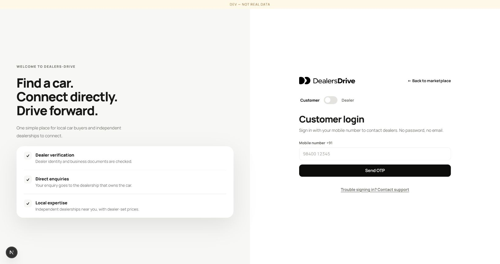

# web / app/(auth)/login

Parent: [web](../../README.md)

The notes below belonged to the files named under each heading. Each heading is the
declaration the note sat above.

## `apps/web/src/app/(auth)/login/page.tsx`

### `export default async function LoginPage({`

**R63** — one Login, two tabs. The header used to say "Dealer login" because
only dealers had accounts; from R62 buyers do too. The Customer tab is the
default because a buyer is the far more common visitor, and `?as=dealer` opens
the Dealer tab — which is what the old `/dealer/login` redirects to.

### `if (audience === 'dealer') {`

A signed-in dealer asking for the Dealer tab is sent where the shared
destination resolver says (R60), exactly as the old dealer sign-in page did.
The customer tab does not redirect a signed-in customer: nothing on the
customer side depends on landing there, and a stale cookie must still be able
to reach the form.

### `if (status?.enabled && status.accepted && requested)`

Customer policy acceptance only resumes navigation when the URL includes an
explicit `returnTo`. A direct visit to `/login` must keep the form accessible,
including its Dealer tab. Redirecting an accepted session to the fallback home
page made the header's Login link flash a blank page and immediately return home.
The post-sign-in and protected-page flows supply `returnTo` and still continue
after acceptance; sessions that need to accept the policies still see the gate.

The customer status helper first verifies the session through the customer API.
A Google-only dealer can therefore reach phone sign-in before or after personal
policy acceptance, including when the URL carries a protected customer destination.
Completing customer identity requirements is separate from accepting policies;
neither step may stand in for the other.

### `if (!isLoginPath(resume)) redirect(resume)`

An accepted customer is never sent back to the login page itself. `returnTo`
is a same-site path, so `/login?returnTo=/login` is a valid one, and resuming it
redirected the page to itself until the browser gave up with too many
redirects. The form renders instead.

### `const dealerReturnTo = requested ? safeReturnPath(requested, '/dealer') : null`

Where a sign-in may send somebody afterwards is decided here, on the server,
once: a path on this site or the fallback. The API sanitises the same value
again (`safeReturnTo`) for both Google and the phone, so an unsafe value is
refused twice rather than trusted once.

### `async function signInWidget(): Promise<PhoneOtpWidget | null>`

The pre-sign-in widget configuration (R60), not the session one. `null` on
failure renders the "unavailable" panel rather than a broken form.
